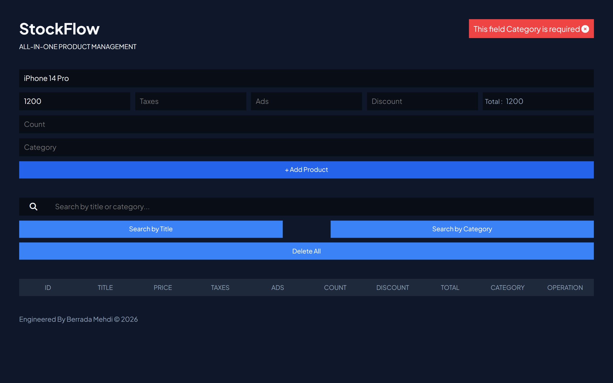
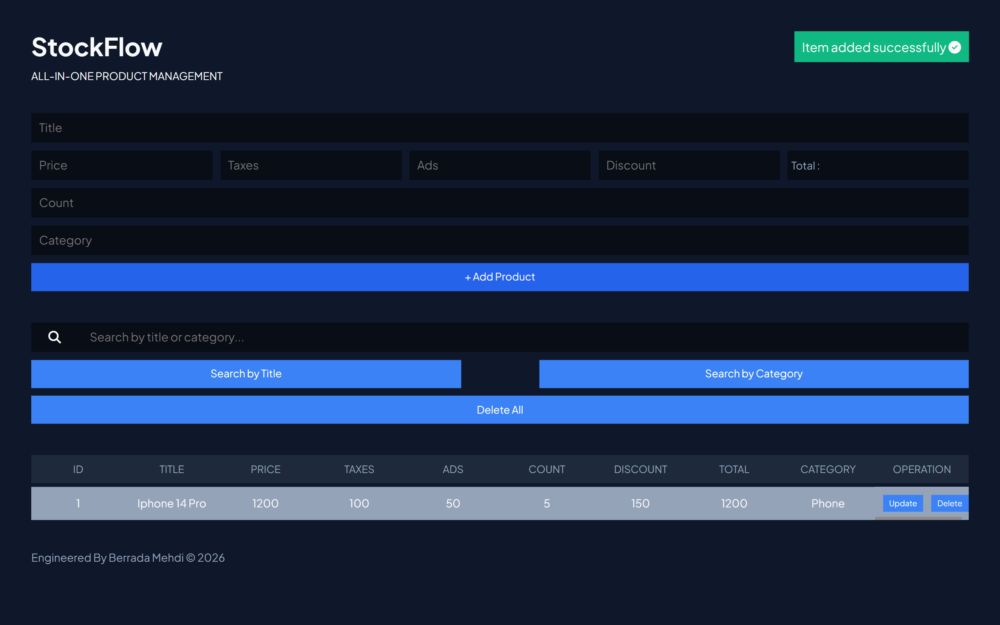
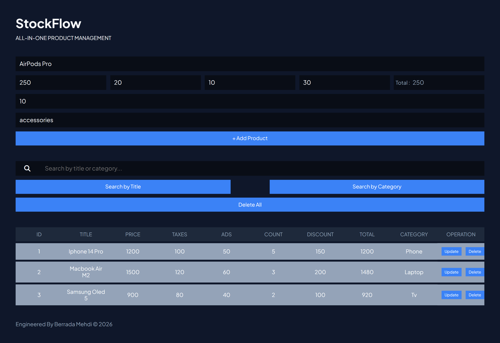
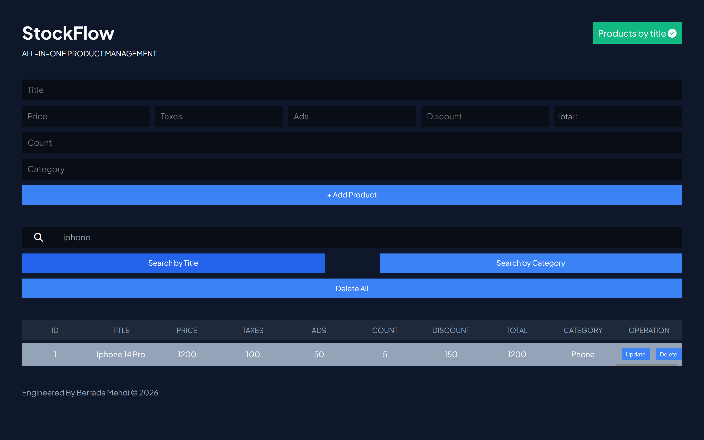
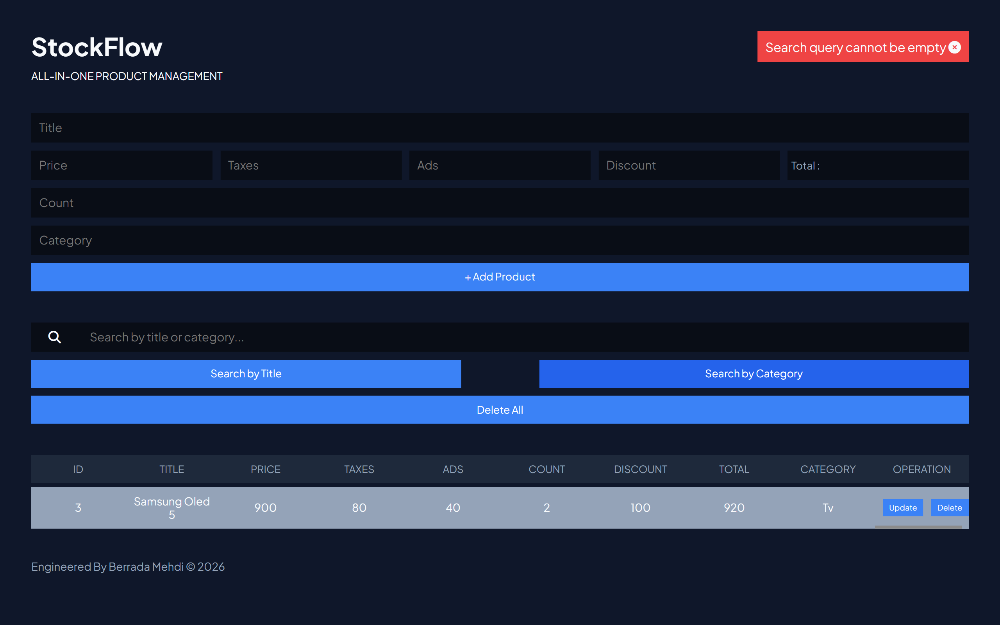
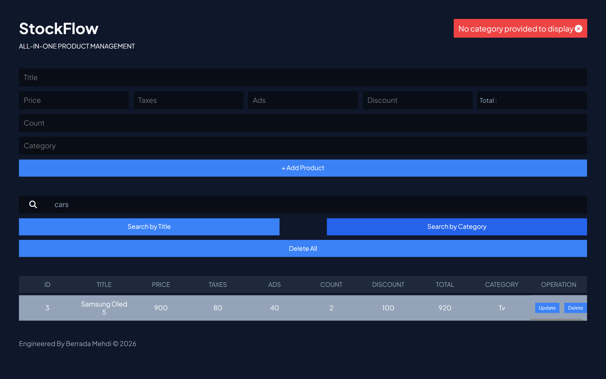
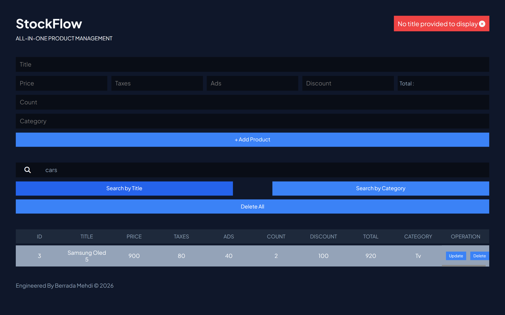
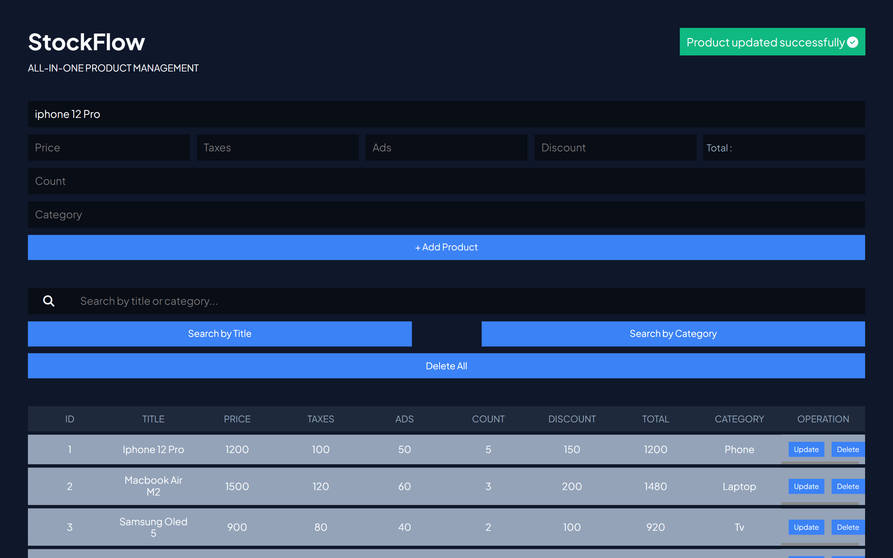
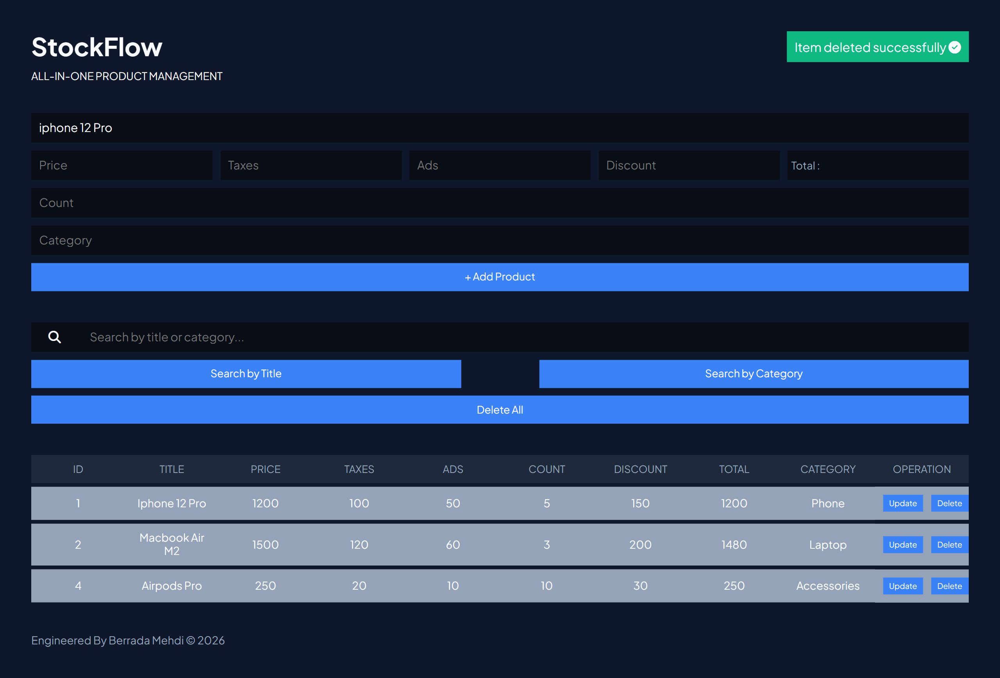
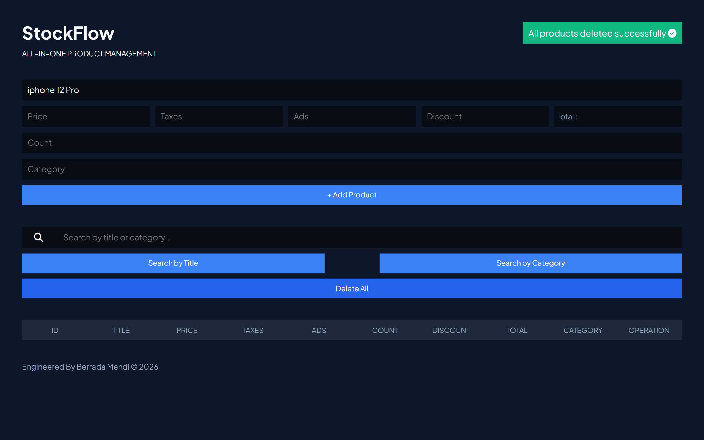

# StockFlow 📦

**All-In-One Product Management Web Application** built with HTML5, CSS3, and Vanilla JavaScript. Designed with a sleek, ergonomic dark UI to manage product inventories, calculate total costs including taxes and discounts, and perform advanced searches efficiently.

---

## 📱 Interface Preview & Key States

<p align="center">
  
  
  
  
  
  
  
  
  
  
</p>

---

## ✨ Features & Capabilities

- **Comprehensive Product Management:** Add, update, and delete individual products or clear the entire inventory (`Delete All`) with a single click.
- **Automated Cost Calculation:** Automatically computes total prices factoring in base price, taxes, advertising costs, and discounts.
- **Advanced Search System:** Instantly filter and search items dynamically by **Title** or **Category**.
- **Real-time Notifications:** Instant feedback alerts for successful product creation, updates, and deletions.
- **Modern Dark UI:** Clean, data-dense, and professional interface tailored for inventory monitoring.

---

## 🛠️ Tech Stack

- **Markup:** HTML5
- **Styling:** CSS3 (Flexbox, Custom Properties, Responsive Layouts)
- **Logic:** Vanilla JavaScript (DOM Manipulation, State Management, Event Handling)

---

## 🚀 Getting Started

### Prerequisites
A modern web browser (Google Chrome, Mozilla Firefox, Microsoft Edge, Safari).

### Installation
1. Clone the repository:
   ```bash
   git clone [https://github.com/berradamehdi/StockFlow-JS.git](https://github.com/berradamehdi/StockFlow-JS.git)